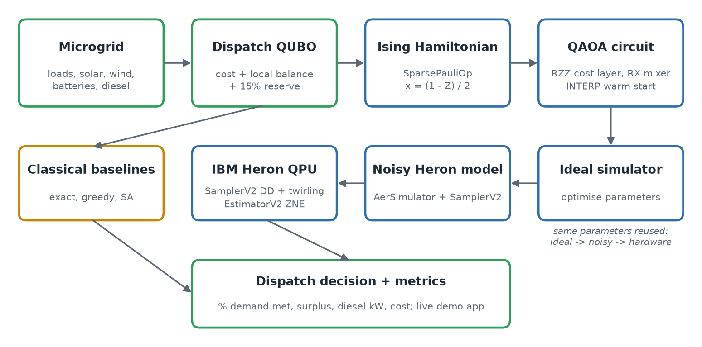
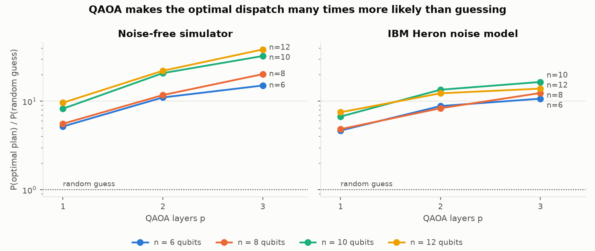
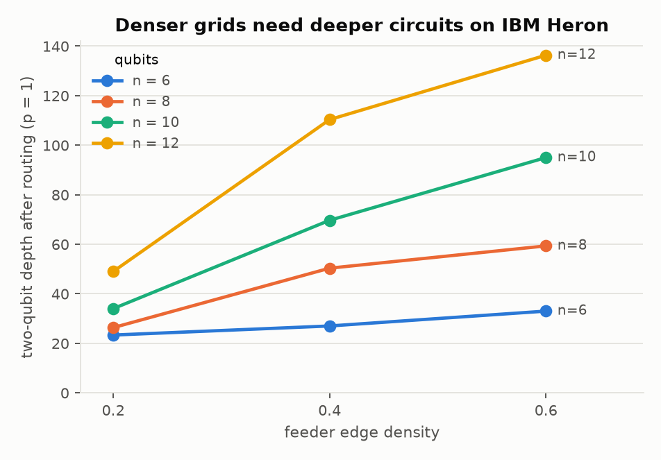
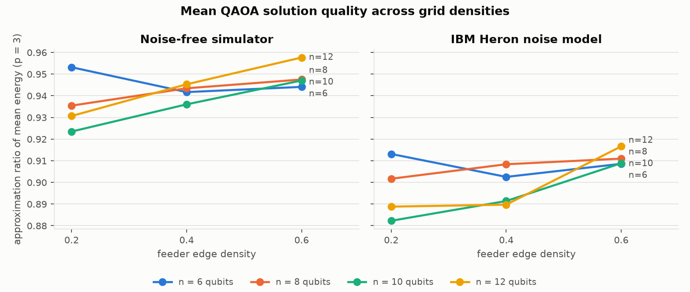
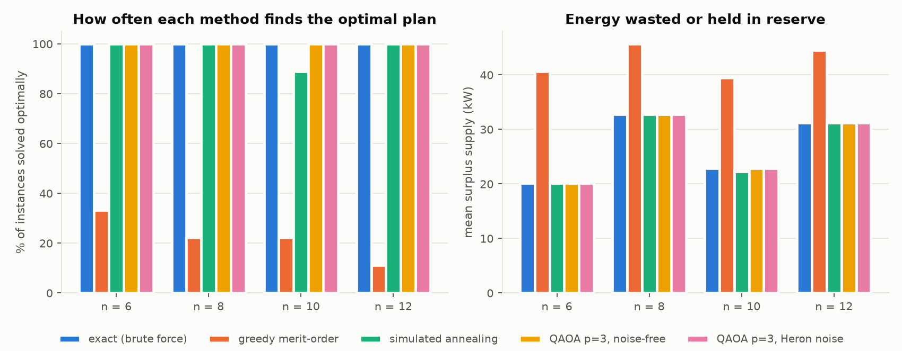

# Quantum-assisted microgrid dispatch

**Team Qilowatt · QFF 2026 · 48-Hour Quantum for Humanity Hackathon · Track: Climate, Energy & Agriculture**

Every hour, the operator of a small off-grid microgrid has to decide which resources to switch on: rooftop
solar, a wind turbine, battery banks, a diesel generator. If they switch on too little, households lose power.
If they switch on too much, clean energy is curtailed or diesel is burnt for nothing. We formulate this
decision as a QUBO, solve it with QAOA in Qiskit, run it on a noise model of IBM's Heron processors (and on
real hardware, see [Hardware run](#hardware-run)), and benchmark it honestly against exact and classical
methods.



**Results at a glance** (36 synthetic microgrids, 6 to 12 nodes = qubits; details in [Results](#results)):

* **The rule of thumb wastes energy.** Greedy merit-order dispatch (cheapest first) finds the optimal plan in only
  8 of 36 grids. It leaves 59% more surplus supply on the grid (42.6 vs 26.7 kW) and meets slightly less demand
  (92.8% vs 93.2%).
* **QAOA finds the optimal plan** in all 36 grids, both noise-free and on an IBM Heron noise model (p = 3, best of
  2,000 shots).
* **Probability goes to the plan that matters.** At 12 qubits, being 95% sure of sampling the optimal plan takes
  about 12,300 random guesses, 425 QAOA shots noise-free, and 1,370 under Heron noise.
* **Honest limit:** simulated annealing solves 35 of 36 grids in 0.16 s. At this size, QAOA has no speed-up.
  What we show is the full pipeline, from microgrid to hardware, and how noise and grid density limit it today.

## The problem and who benefits

* **Who:** communities served by small microgrids (villages, islands, farms, clinics) and the cooperative or
  utility that operates them.
* **Decision:** which of the `n` local resources to dispatch for the next hour.
* **What goes wrong today:** dispatch by hand or by simple merit order. Too little supply means blackouts.
  Too much means curtailment of clean energy or unnecessary diesel.
* **What we measure:** % of demand met, surplus energy (reserve plus curtailment), diesel kW and generation
  cost, for every method on the same instances.

> Team note: add one or two verified statistics about the community you pitch (with sources) here.
> Every number in this repository is synthetic.

## Approach

### 1. Model (`src/microgrid/instance.py`)

* `n` nodes (6 to 12 here; one node = one qubit). Each node has a local demand `d_i` and one dispatchable resource
  with capacity `p_j` and cost `c_j` (solar, wind, battery or diesel; ranges are documented assumptions).
* Feeders follow geography: a minimum spanning tree over random positions plus the shortest extra links until
  a target edge density is reached.
* A dispatched source shares its output with itself and its direct feeder neighbours, in proportion to their
  demand (`A_ij`). Power travels one hop only, a simple stand-in for the short reach of low-voltage rural feeders.

### 2. QUBO (`src/microgrid/qubo.py`)

```
E(x) = sum_j c_j p_j x_j  +  lambda * sum_i ( sum_j A_ij x_j  -  (1 + r) d_i )^2
```

* The first term is generation cost (USD/h). The second penalises both blackout and waste at every node.
* `r = 15%` is an operating reserve. The quadratic penalty is symmetric, so the reserve is what tilts the optimum
  towards keeping the lights on.
* `lambda = VOLL / mean(d)` with a value of lost load `VOLL = 2 USD/kWh`, an illustrative assumption.
* Two sources interact only if they can reach a common node, so **sparse grids give sparse QUBOs** (fewer `ZZ`
  terms, shallower circuits). This makes feeder density a natural experimental knob.
* Tests check the expanded QUBO against the objective written term by term, and the Ising diagonal against the
  QUBO on every bitstring (`tests/test_qubo.py`).

### 3. QAOA (`src/microgrid/qaoa.py`)

* Ising map `x_j = (1 - Z_j) / 2` gives a `SparsePauliOp` plus a constant offset.
* An explicit circuit: Hadamards, then `p` layers of `RZ` / `RZZ` cost gates and an `RX` mixer.
* **Normalised cost Hamiltonian.** We divide by the largest coefficient so good angles are comparable across
  instances. This is what makes parameter transfer work.
* **Mixer sign** `exp(+i beta sum X)`: a linear ramp start is then a Trotterised adiabatic path.
* **Layer-wise training.** `p = 1` starts from a coarse grid and a linear ramp. Each `p + 1` is warm-started with
  INTERP (Zhou et al., PRX 2020). Parameters from smaller instances are also tried as starting points.
* **Objective.** Either the mean energy or **CVaR** (mean of the best 25% of outcomes, Barkoutsos et al.,
  Quantum 2020). CVaR raises the probability of sampling the optimum (see `notebooks/02_benchmark.ipynb`).
* The objective is evaluated classically from the output distribution, so the same code runs on the
  statevector simulator, on a noisy model and on hardware through any `SamplerV2`.
* The answer we use is the **best sampled bitstring**, which is how QAOA is used in practice.

### 4. Execution (`src/microgrid/hardware.py`)

| Mode | How | Used for |
|---|---|---|
| Ideal | `qiskit.quantum_info.Statevector` | Training parameters (cheap, exact) |
| Noisy model | `AerSimulator.from_backend(FakeFez)` + `qiskit_ibm_runtime.SamplerV2` | Same parameters under a Heron r2 noise model |
| Hardware | `SamplerV2` with dynamical decoupling (XpXm) and gate and measure twirling; `EstimatorV2` with ZNE (noise factors 1, 3, 5) | Final runs in `Batch` mode, job IDs logged |

Circuits are transpiled with `generate_preset_pass_manager(optimization_level=3)` for the target device, and
we report depth and two-qubit depth.

### 5. Classical baselines (`src/microgrid/baselines.py`)

* **Exact:** brute force over all `2^n` dispatches. Ground truth, feasible up to about 25 nodes.
* **Greedy merit-order:** switch on the cheapest sources first while the objective improves. This is what an
  operator does by hand.
* **Simulated annealing:** single-flip Metropolis, 8 restarts × 500 sweeps.

## Results

Simulator results. Instances: n = 6, 8, 10, 12; feeder density 0.2, 0.4, 0.6; 3 seeds each (36 instances).
QAOA uses p = 1 to 3 layers with 2,000 shots. The noisy rows reuse the noise-free parameters on a Heron r2 noise
model. Full tables: [`results/summary.md`](results/summary.md). Raw data: [`results/benchmark.csv`](results/benchmark.csv).

**All 36 instances.** QAOA uses p = 3 and reports the best of 2,000 shots. QAOA runtime includes parameter
training on a laptop simulator. The noisy runtime is local simulation time, not QPU time.

| Method | optimal plan found | demand met | surplus (kW) | generation cost (USD/h) | runtime |
|---|---|---|---|---|---|
| Exact (brute force) | 36 / 36 | 93.2% | 26.7 | 16.19 | < 0.01 s |
| Greedy merit-order | 8 / 36 | 92.8% | 42.6 | 14.36 | < 0.01 s |
| Simulated annealing | 35 / 36 | 93.2% | 26.6 | 16.17 | 0.16 s |
| QAOA, noise-free | 36 / 36 | 93.2% | 26.7 | 16.19 | 3.3 s |
| QAOA, Heron noise model | 36 / 36 | 93.2% | 26.7 | 16.19 | 15.5 s |

Greedy has a lower generation cost because it switches on cheap sources wherever they are. The optimum
spends 1.83 USD/h more to put supply where the demand is, and cuts surplus by 37%.

**How QAOA scales with qubits** (p = 3, mean over 9 instances per row).

| n | P(optimal) vs random, noise-free | vs random, Heron noise | shots for 95% confidence: random / QAOA / QAOA noisy | two-qubit depth after routing |
|---|---|---|---|---|
| 6 | 15.0× | 10.7× | 190 / 15 / 21 | 97 |
| 8 | 20.2× | 12.4× | 765 / 46 / 83 | 137 |
| 10 | 32.4× | 16.5× | 3,066 / 133 / 332 | 201 |
| 12 | 38.5× | 13.9× | 12,269 / 425 / 1,367 | 230 |

| | |
|---|---|
|  |  |
|  |  |

### What the numbers say (and do not say)

* **"Found the optimum" is a weak metric at small n.** With 2,000 shots, random guessing also finds the optimum
  at 6 to 8 qubits, and 86% of the time at 10 qubits. At 12 qubits, it succeeds only 39% of the time. The
  shots-to-95% column is the fair comparison, and the gap widens as n grows.
* **Noise erodes the gain as circuits grow.** Noise-free, the advantage over guessing keeps rising with n,
  from 15× to 38.5×. Under the Heron noise model, it levels off at 11 to 17×. The approximation ratio of the
  mean energy drops from 0.945 to 0.898 at 12 qubits.
* **Sparse grids are the hardware-friendly regime.** At 12 qubits and p = 1, raising feeder density from
  0.2 to 0.6 raises the QUBO couplings from 26 to 64, and two-qubit depth from 49 to 136.
* **The impact case does not depend on quantum.** The rule of thumb operators use today wastes energy,
  and optimising (by any method) fixes it. QAOA is a path to the larger, multi-hour versions of this problem,
  where exact methods stop scaling. That still has to be shown on hardware larger than today's.

## Hardware run

`notebooks/03_hardware.ipynb` takes parameters trained on the simulator and spends hardware time only on
sampling. It runs two `SamplerV2` jobs (raw, and with dynamical decoupling and twirling) and one `EstimatorV2`
job with zero-noise extrapolation. Each job ID is appended to `results/hardware_jobs.jsonl`.

* Status: <!-- HARDWARE-STATUS --> not yet run on a real device. The notebook has been run end to end on the local
  Heron noise model (`results/noisy_model_results.json`).
* The ZNE estimator step runs on real hardware only. In local fake-backend mode, the runtime Estimator measures
  all 156 device qubits, which a laptop simulator cannot hold.
* On the local noise model, dynamical decoupling and twirling do not improve results. That model's noise is
  already stochastic, which is exactly what twirling produces, so the suppression has nothing to fix. On real
  devices, coherent errors and crosstalk are what these techniques target.

## How to run

```bash
python -m venv .venv
# Windows: .venv\Scripts\activate    macOS/Linux: source .venv/bin/activate
pip install -r requirements.txt
pip install -e .        # or skip it and set PYTHONPATH=src (see the note below)

pytest                                            # 20 tests, about 10 s
python -m microgrid.benchmark --n 6 8 --density 0.3 --seeds 0 --max-p 2 --noisy   # quick check, about 1 min
python -m microgrid.benchmark --n 6 8 10 12 --density 0.2 0.4 0.6 --seeds 0 1 2 --max-p 3 --shots 2000 --noisy --noisy-seeds 0 1 2   # full sweep, about 30 min
python -m microgrid.benchmark --replot            # rebuild summary.md and figures from results/benchmark.csv
streamlit run app/streamlit_app.py                # interactive demo
```

Windows note: `pip install -e .` fails if the clone's path contains non-ASCII characters (setuptools prints
the path to a cp1252 console). Clone to a plain path such as `C:\qff26`, or skip the install and set
`$env:PYTHONPATH="src"` (PowerShell) or `export PYTHONPATH=src` (bash). Tests, notebooks and the app find
`src/` on their own.

Notebooks: `01_formulation` (model to QUBO to Ising, exact solution), `02_benchmark` (QAOA layer by layer, CVaR, saved
sweep), `03_hardware` (IBM Quantum run; set `USE_REAL_HARDWARE = True` after saving your account).

To run on IBM Quantum, save your credentials once (never commit them):

```python
from qiskit_ibm_runtime import QiskitRuntimeService
QiskitRuntimeService.save_account(channel="ibm_quantum_platform", token="<API key>", instance="<CRN>")
```

## Repository layout

```
src/microgrid/   instance.py  qubo.py  qaoa.py  baselines.py  metrics.py  hardware.py  benchmark.py
app/             streamlit_app.py         interactive demo
notebooks/       01_formulation  02_benchmark  03_hardware
tests/           QUBO <-> Ising equivalence, baselines, primitives, CVaR, INTERP
docs/            architecture.md, architecture.png (make_architecture.py)
results/         benchmark.csv, summary.md, figures/, hardware and noisy-model runs
pitch/           3-minute video script, 5-minute live pitch, Q&A preparation
```

## Limitations

* **Synthetic data.** Capacities, costs, demand, VOLL and the reserve margin are illustrative assumptions.
* **Simplified physics.** One time step, binary on/off, one-hop proportional sharing. There is no AC power
  flow, no line thermal limits and no battery state of charge.
* **Symmetric penalty.** A quadratic penalty cannot weight blackouts above curtailment directly. The reserve
  margin only shifts the target.
* **No quantum advantage.** At 6 to 12 nodes, brute force and simulated annealing solve every instance faster.
  QAOA finds the optimum too, but this is a pipeline and scaling study, not a speed-up claim.
* **Noise model is not hardware.** The noisy results come from a calibration snapshot, not from a live device.

## Next steps

1. Multi-hour dispatch with battery state of charge, which needs more qubits per node and makes the problem
   harder classically.
2. Sparse feeders with 50 to 100 nodes on Heron, where brute force stops working, compared against a MILP solver.
3. Real load and solar profiles from a partner microgrid. Calibrate VOLL and the reserve margin with the operator.
4. Asymmetric penalties through slack variables, so the model can weight blackouts above curtailment.

## References

* E. Farhi, J. Goldstone, S. Gutmann, *A Quantum Approximate Optimization Algorithm*, arXiv:1411.4028 (2014).
* L. Zhou et al., *Quantum Approximate Optimization Algorithm: Performance, Mechanism, and Implementation on
  Near-Term Devices*, Phys. Rev. X 10, 021067 (2020). INTERP initialisation.
* P. Barkoutsos et al., *Improving Variational Quantum Optimization using CVaR*, Quantum 4, 256 (2020).
* Qiskit SDK, Qiskit Aer and Qiskit IBM Runtime: https://github.com/Qiskit

## Team

**Qilowatt** (solo entry): <!-- your name and Discord handle --> covering the quantum core, classical
baselines, demo app and pitch. Built during the QFF 2026 48-hour hackathon.

## License

Apache-2.0. See [LICENSE](LICENSE).
