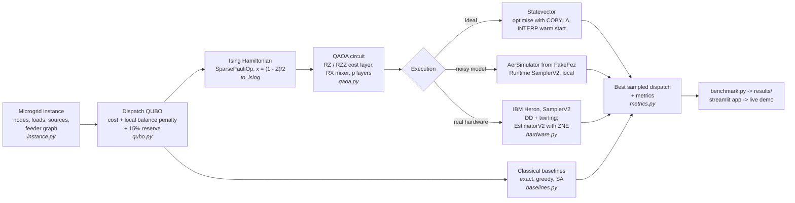

# Architecture

## Data flow

1. `make_microgrid(n, density, seed)` builds a connected feeder graph (minimum spanning tree plus the shortest extra links) and samples one resource per node.
2. `build_qubo` writes the objective as `constant + h.x + x.J.x`. Two sources are coupled only when they can reach a common node, so the number of `ZZ` terms grows with feeder density.
3. `to_ising` returns the Hamiltonian and its constant offset. The QAOA cost layer uses the Hamiltonian normalised by its largest coefficient, so parameters transfer between instances.
4. Parameters are optimised once on the noise-free simulator. The same parameters are then run on the noisy model and on hardware. This keeps hardware usage to a few jobs.
5. Every method's answer goes through the same `dispatch_report`: % demand met, surplus, diesel use, cost.

## Execution on IBM hardware

| Step | API | Notes |
|---|---|---|
| Pick device | `QiskitRuntimeService().least_busy(min_num_qubits=n)` | Heron r2 (`ibm_fez`, `ibm_marrakesh`, ...) |
| Transpile | `generate_preset_pass_manager(optimization_level=3, backend=...)` | Reports depth and two-qubit depth |
| Sample | `SamplerV2` with dynamical decoupling (XpXm) and gate and measure twirling | Best bitstring = dispatch decision |
| Energy | `EstimatorV2`, `resilience_level=2`, ZNE noise factors 1, 3, 5 | Checks how far noise pulls `<H>` from the ideal value |
| Audit | `log_job` appends job IDs to `results/hardware_jobs.jsonl` | Judges can look the jobs up |
